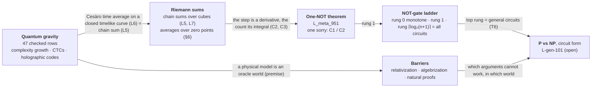

# pnp-general (by addison-jpg)

The higher level gist is: quantum/gravity relativity maps onto the relativity barrier to P/NP, and can help bypass it. 

**Claim of this repository.** Lower bounds for circuits of AND, OR and NOT gates, written as a formal proof. Each numbered item below is a Definition, Lemma, Theorem, Conjecture or Counterexample; each says whether it is **checked** (the Lean checker accepted it, axioms `propext`, `Classical.choice`, `Quot.sound`), **paper**, or **tested n/N**. Nothing here says that P versus NP is settled. Names: [`NAMES.md`](NAMES.md). Sources: [`LITERATURE.md`](LITERATURE.md). Work in progress: [`BOARD.md`](BOARD.md) and the four boards under [`boards/`](boards/).

---

## At a glance

| | |
|---:|:---|
| **54** | rows checked in Lean: **47 quantum gravity**, 7 general circuit rows ([`lean/PEqualNP/QuantumGravity/`](lean/PEqualNP/QuantumGravity/README.md), [`lean/PEqualNP/General/`](lean/PEqualNP/General/)) |
| **1** | `sorry` left in the one-NOT development (`no_minCE`), and two conjectures that would close it (C1, C2) |
| **0** | failures of the count \|`realWitness`\| ≥ `base`: 19,534 suite instances and 80,198 Fano circuits × 128 cubes |
| **60+** | refuted statements, each with a counterexample ([`one-not/DEAD_ENDS.md`](one-not/DEAD_ENDS.md)) |
| **3** | barriers checked as Lean statements: relativization, algebrization, natural proofs |
| **⌈log₂(n+1)⌉** | NOT gates already give all circuits up to polynomial size (Markov, Fischer; checked) |

## One map, four programs

### Quantum gravity → complexity (47 rows, checked)

Several arguments in quantum gravity are arguments about computational complexity: complexity = volume / = action, the hardness of decoding
Hawking radiation, the hardness of the AdS/CFT dictionary, computers on closed timelike curves, bounds on the number of states of a region.
Each rests on a classical, finite core: a counting bound, a fixed point, a reduction. This program states those cores in Lean and checks them.
Physical premises appear in no Lean statement. Overview: [`lean/PEqualNP/QuantumGravity/README.md`](lean/PEqualNP/QuantumGravity/README.md).

| Theme | What is checked | Rows |
|---|---|---|
| **Complexity growth** (complexity = volume / action) | gate-word counting, (\|S\|+1)^k bounds and hard reversible maps; subadditivity; at most linear growth in time; minimal prefixes; linear growth up to exponential length; recurrence to zero in a finite group; local reversible circuits are exponentially hard; no countable exactly-universal gate set; errors add; approximate complexity; compiling gate sets; reversible ⊂ quantum; Haar-ball ⇒ Knill counting; the counting bound gives a hard unitary | L-qg-001–007, 101, 110–114, 117, 118 |
| **Closed timelike curves** (Deutsch consistency, P_CTC) | a consistent state always exists: classical, probabilistic (stationary distribution) and quantum (fixed density matrix of every Kraus channel; unital case; classical embeddings); a CTC finds solutions; P_CTC is never vacuous; P ⊆ P_CTC; **NP ⊆ P_CTC and coNP ⊆ P_CTC** (Brun; Aaronson–Watrous); closure under complement; Brun's counter; the deterministic decision rule | L-qg-008, 009, 102, 120–127, 160–168 |
| **Holography and codes** (bulk reconstruction, perfect tensors) | finite-state holographic bound; the five-qubit code is a distance-3 stabilizer code, recovers from the loss of any two qubits, distance not four; the six-qubit perfect state and its Lagrangian stabilizer group; the code inside the perfect state (stabilizers, logical operators); operator pushing through the perfect tensor; the counts 16 / 64 / one logical qubit; distance-d codes recover from < d erasures | L-qg-010, 140–149 |
| **Hardness assumptions** | if P = NP, every polynomial-time length-preserving function is invertible in polynomial time (so one-way functions imply P ≠ NP) | L-qg-103 |

**Two routes to P vs NP, neither settles it.** *Assumption route:* hardness arguments in gravity assume a primitive; classical one-way
functions imply P ≠ NP (L-qg-103), while quantum-only primitives (pseudorandom states, EFI) are not known to (Kretschmer's oracle).
*Model route:* physics fixes the machine model; with closed timelike curves one pass of a polynomial-size circuit decides SAT (L-qg-009 and the
P_CTC rows). **Open:** L-qg-115 (Haar measure of an operator-distance ball ≤ (C ε)^(4^n), Knill 4.3 / Szarek), L-qg-116 (Knill's quantum
counting bound), L-qg-119 (two-qubit circuits are Haar-null when 9k + 3n + 1 < 4^n, Knill 3.4), L-qg-169 (P_CTC ⊆ EXP).

### Riemann sums: chain sums, averages and the time average

The step of the proof is a derivative and the count is its integral. Three sums, all over finite objects, carry the idea (details in §6):

- **Chain sum (L5, checked).** Along every chain of cubes, slack(∅) = Σ_i (gain_i − cost_i). The Theorem needs only the sum to be ≥ 0
  (integral form); Conjecture C2 asks every term to be ≥ 0 (pointwise form); C3 asks for paths of at most k points; **L7 (checked)** proves the
  Theorem from a descent with any number of points. Every counterexample to the pointwise form has a positive sum (+6, +15).
- **Average over zero points (the fractional form).** Each set w spreads a probability distribution μ_w over its zero points so that no gate
  carries more than one unit: Σ_w Pr_{z∼μ_w}[g ∈ M_z(w)] ≤ 1 for every gate g. Summed over gates this gives base ≤ #gates. Its LP dual is the
  price inequality; the reduction of `no_minCE` to the price form is checked in the one-NOT development; real merge sets fail it
  (`Cex.starOfFourPairsWithAThresholdNOTInput`), and its lifted two-gate case has a paper proof (an odd-triangle parity argument).
- **Time average (L6, checked).** A Deutsch-consistent state of a closed timelike curve is reached by Cesàro averages, and the displacement is
  (end − start)/(n+1). L5 and L6 are the same identity; this is the link the gist names (a premise: it selects statements, it proves none).
- **The limit.** A Riemann sum over inputs at one length (2⁻ⁿ Σ_x f(x), the "hypercomplex polynomial" / Walsh expansion) is a property of
  the function and cannot see circuit size; across lengths there is no coherence to take a limit of. The sums that see size run over cubes,
  chains and zero points (issue 12; [`one-not/DEAD_ENDS.md`](one-not/DEAD_ENDS.md), family G).

### The one-NOT theorem (rung 1)

One NOT gate saves nothing on (1,1)-disjoint Boolean sums (statement below). Without the NOT gate this is the theorem of Wegener and Mehlhorn.
**Proved (checked):** every circuit whose lift wins the certificate game (T1, T2); the NOT gate reads an input (T3, no minimality); every cube
that is local (T4); all |S_w| ≤ 3, and every circuit with no output in two-world normal form, for any number of NOT gates (T5).
**Open:** exactly the minimal counterexamples whose lift loses the game: C1 (a disjoint system of lifted classes) or C2 (a positive point step
under `MinCE.no_rewire`). If true for every number t of NOT gates (C4(t)), dense designs would give a superlinear lower bound for general
circuits, which is not known for any explicit function.

### The ladder and the general gaps

| Rung | Status |
|---|---|
| 0 NOT gates (monotone) | exponential bounds (Razborov 1985); exact `base` for Boolean sums (Wegener, Mehlhorn) |
| **1 NOT gate** | **the Theorem below: one `sorry`** |
| t NOT gates | Conjecture C4(t); Amano–Maruoka 2005; a circuit with t NOT gates is a parity of O(2^t) monotone functions (Blais et al., arXiv 1410.8420), and t = 1 is the two-world split used here |
| ⌈log₂(n+1)⌉ NOT gates | **checked**: as strong as unrestricted circuits up to polynomial size (T6, L-gen-104) |
| unrestricted | **checked:** L-gen-001–004 (the gaps imply each other; the ladder is monotone; its top is the general case), XOR: C(x ⊕ f) ≥ max(C f, C ¬f) + 3, = min + 4 when C(f) ≠ C(¬f) (L-gen-005, 006), C(f) + 1 ≤ C(¬x ∧ f) ≤ C(f) + 2 (L-gen-007). **Open:** L-gen-101 (NP ⊄ P/poly, = P ≠ NP in circuit form), 102 (NP ⊄ SIZE(n^k) for every k; Kannan proves it one level up), 103 (no linear-size circuits; best known ≈ 5n, 3.1n by Li–Yang 2022), the XOR case C(f) = C(¬f) |

### Barriers

The three barriers are checked as Lean statements (T8). The techniques of this repository are placed against them:

| Technique | Relativization | Algebrization | Natural proofs | Reach |
|---|---|---|---|---|
| merge counting, lifted classes, witness gates | not ruled out: reads AND/OR gate semantics | not ruled out: Boolean points and monotonicity only | not ruled out: the property is not large | linear; 2^t worlds with t NOT gates |
| chain sums and averages (L5, L7, prices) | same | same | the parity step is a design fact, not a property of random functions | linear |
| physical models (quantum gravity) | a physical model is an oracle world: it says which arguments cannot work in which world | — | spectral / Fourier arguments are natural (L-lib-086) | selects statements |

---

# Part II — the formal proof

## Theorem (`L_meta_951`, one `sorry`)

Let S_1, …, S_m ⊆ {1, …, n} with |S_w| ≥ 2 and |S_v ∩ S_w| ≤ 1 for v ≠ w. Let C be a circuit of fan-in-2 AND and OR gates and at most one NOT gate whose w-th output is the OR of the inputs in S_w. Then

    #gates(C) ≥ base := Σ_w (|S_w| − 1).

Without the NOT gate this is the theorem of Wegener and Mehlhorn, and `base` is exact. The statement is rung 1 of the NOT gate ladder (§7).

## 1. Definitions

- **D1** `MinCE`. A minimal counterexample: a correct circuit with #gates < `base` and the fewest gates among such.
- **D2** `notInput`, `faceZero`, `faceOne`. h is the wire the NOT gate reads. Replacing the NOT gate by 0 or by 1 gives two monotone circuits with `faceZero` ≤ C ≤ `faceOne`.
- **D3** `cube`, `CubeLocal`. The cube of Q is the set of inputs with x_v = 1 for v ∈ Q. It is local when h, restricted to it, is one input or constant.
- **D4** `ZeroPoint`, `atom`, `mergeSet`. A zero point of S_w is an input that is 0 on S_w; an atom is a zero point with one point of S_w switched on. A union-find run over S_w at a zero point marks the OR gates that join two blocks: the merge set.
- **D5** `realWitness` (old: F2). The OR gates g with g(Z) = 0 and g(Z + e_u) = g(Z + e_u') = 1 for a zero point Z of a set that avoids Q and two points u ≠ u' of it.
- **D6** `lift`, `LTS`, `LTSCert`, `UGameWon`. The lift replaces the NOT gate by a fresh input. A lifted test system of a set is a zero point with atoms in the lift. A pair of sets has a certificate when at most one atom of one system is not below the zero point of the other. The certificate game is won when every set has a system and every pair has a certificate in one direction.
- **D7** `LiftSDR`. One lifted class per set, pairwise disjoint, each of size |S_w| − 1.

## 2. Lemmas

- **L1** `merge_run` (checked). Every merge set of S_w has exactly |S_w| − 1 gates.
- **L2** `MinCE.no_const`, `MinCE.no_dup`, `MinCE.no_var`, `MinCE.live`, `MinCE.not_used`, `MinCE.observable`, `MinCE.no_rewire` (checked). In a minimal counterexample: no constant gate; no two gates compute the same function; no gate computes an input; every gate is read; both faces are incorrect; no constant on any set of readers of a wire keeps the circuit correct; no rewiring of a gate input leaves a gate unread.
- **L3** `no_minCE_of_liftSDR` (checked). If every minimal counterexample has `LiftSDR`, there is none.
- **L4** (paper, refereed). Any argument that reads only gate values at test points proves exactly the won games (Proposition S); with outputs in two-world normal form and all |S_w| ≥ 3 a winning choice stays in one world (Theorem D); a merge gate splits every set it serves by one colouring (Lemma T).

## 3. Theorems

- **T1** `liftSDR_of_ugame`, `no_minCE_of_ugame` (checked). `UGameWon` ⇒ `LiftSDR`. Hence the Theorem holds for every circuit whose lift wins the certificate game.
- **T2** `ugame_of_G1`, `ugame_of_G0`, `ugame_of_allHeavy`, `ugame_of_typeB` (checked). The game is won in four named cases.
- **T3** `muF2_of_notVar` (checked). The Theorem holds when the NOT gate reads an input, with no minimality.
- **T4** `no_minCE_of_gainF2_or_cubeLocal`, `no_minCE_of_gainF2_or_local`, `baseDQ_le_F2_of_LW1` (checked). If at every cube with positive `base` the cube is local, or satisfies LW1, or some point v has gain(v) ≥ cost(v) for `realWitness`, there is no minimal counterexample.
- **T5** `small3_bound`, `bound_of_noDD`, `partial_bound` (checked). The Theorem holds when all |S_w| ≤ 3; when no output is in two-world normal form (any number of NOT gates); and a partial bound.

## 4. Proof of the Theorem, as far as it goes

Suppose the Theorem fails and take a minimal counterexample (D1). By L2 it is clean. If its lift wins the certificate game, T1 gives `LiftSDR` and L3 a contradiction. ∎ in that case.

**Open (the one `sorry`, `no_minCE`).** A minimal counterexample whose lift loses the certificate game.

- **Conjecture C1.** Every minimal counterexample has `LiftSDR`. Smallest lost game: S = {0,1,2}, {0,3,4}, h = x_1 ∨ x_3; a violation there is a configuration of three gates. Hard core: `Cex.threeFourSetsInATriangle` (old: cxT2), which satisfies L2 and loses the game.
- **Conjecture C3** (§6): the k-point step, the integral form of C2.
- **Conjecture C2.** Under `MinCE.no_rewire`, at every non-local cube some point has gain ≥ cost for `realWitness` (then T4 closes the proof).
- **Tested, no failure.** |`realWitness`(Q)| ≥ `base`(Q) at every cube of every suite (19,534 suite instances; 80,198 Fano circuits × 128 cubes).

## 5. Refuted, each with its counterexample

Seven families, 60+ rows: [`one-not/DEAD_ENDS.md`](one-not/DEAD_ENDS.md). The ones a new proof must not repeat:

| Refuted statement | Counterexample |
|---|---|
| induction that sets a point to 0 | `Cex.fanoFormulaWithAnUnusedNOTGate` |
| point step for one-face witness gates | `Cex.pappusConfigurationWithJunkGates` |
| point step for `realWitness`, all correct circuits | `Cex.twinBalancedORTreesWithLeafJunk` |
| the same under L2 without `no_rewire`, at a non-local cube | `Cex.matchedTwinTreesWithA14InputNOTInput` |
| disjoint representatives over pure classes, all correct circuits | `Cex.twoTwoWorldSetsSharingOneMergeGate` |
| price inequality over real merge sets, without minimality | `Cex.starOfFourPairsWithAThresholdNOTInput` |
| correctness on inputs of weight ≤ k only, any fixed k | Hiltgen and Paterson 1995; AG(2,25) construction |

## 6. The chain sum (Riemann sum) and the gravity/quantum link

How the proof extends itself: the step is a derivative, the count is its integral.

- **D8** `chain`, `gain`, `cost`, `slack`. A chain is an order v_1, …, v_n of the points, with cubes Q_i = {v_1, …, v_i}. gain_i = |`realWitness`(Q_{i−1}) \ `realWitness`(Q_i)|. cost_i = Σ (|S_w| − 1) over the sets that avoid Q_{i−1} and contain v_i. slack(Q) = |`realWitness`(Q)| − `base`(Q).
- **L5** chain sum. For every chain: Σ_i gain_i = |`realWitness`(∅)| and Σ_i cost_i = `base`. Hence slack(∅) = Σ_i (gain_i − cost_i): the count is the sum of the steps along any chain. Checked for every decreasing chain of finite sets: `ChainSum.card_eq_card_add_sum_gain`, `base_le_card_iff_sum_cost_le_sum_gain`, `base_le_card_of_step` (`one-not/lean/PEqualNP/W951/ChainSum.lean`). The instance (`realWitness` decreases along a chain, each set is paid once) is tested on 420 of 420 chains.
- **Reading.** Conjecture C2 asks every term gain_i − cost_i ≥ 0 for some chain: the pointwise form. The Theorem needs only the sum ≥ 0: the integral form. Every counterexample of §5 to the pointwise form has one term −1 and a positive sum (twin trees: +6; matched twin trees: +15).
- **Conjecture C3** (k-point step, new). At every cube with positive `base` some path of at most k points has Σ (gain − cost) ≥ 0 at its end. k = 1 is C2; k = n is the count; C3 for any fixed k proves the Theorem by the same induction. Tested at the empty cube: k = 2 suffices on all 21 counterexample circuits, including every circuit that refutes k = 1.
- **L7** descent for a variable number of points (checked, `ChainSum.slack_nonneg_of_descent`). If at every cube with positive `base` some strictly larger cube has slack no larger, then slack ≥ 0 at every cube. No bound on how many points one move adds: this is C3 for every k at once (C_n). So the Theorem follows from: *every cube with positive base has a larger cube whose slack is no larger*.
- **D9** `witness` (general witness gates). The condition of D5 for a gate of ANY type in a circuit with ANY number of NOT gates: g(Z) = 0 and g(Z + e_u) = g(Z + e_u') = 1. L5 and L7 hold for it unchanged (they are about decreasing chains of finite sets). Tested: rewriting OR gates as NOT(AND(NOT, NOT)), up to 106 NOT gates, drives the OR-only family to 0 gates and leaves the general family ≥ `base` on 39 of 39 rewrites (`one-not/tools/kill_tests/witness_any_gate.py`). These are rewrites, not adversarial circuits.
- **Conjecture C4(t)** (the count for a variable number t of NOT gates). In a correct circuit with t NOT gates, |`witness`(∅)| ≥ `base`, hence #gates ≥ `base`. C4(0) is the theorem of Wegener and Mehlhorn. C4(1) is the Theorem. C4(t) for all t says general circuits do not beat `base` on (1,1)-disjoint Boolean sums. In the literature this is an open question, not a named conjecture: Jukna and Sergeev 2013 §7 ask whether AND / OR / NOT circuits help for Boolean sums; Blum, ECCC TR24-179, proposes (1,1)-disjoint sums with negations as a target. A positive answer for dense designs (`base` ≈ n^{3/2}) would be a superlinear lower bound for general circuits, which is not known for any explicit function; so C4(t) for large t is at least that hard, and may be false.
- **L6** time average (checked, `QuantumGravity/Helpers/FixedPoint.lean`: `cesaro_mem`, `cesaro_displacement`; rows L-qg-008, L-qg-102). A Deutsch-consistent state of a closed timelike curve is reached by Cesàro averages a_n = (n+1)⁻¹ Σ_{k ≤ n} f^k(x_0) of the orbit, and f(a_n) − a_n = (n+1)⁻¹ (f^{n+1}(x_0) − x_0): the sum of the steps is the difference of the end points.
- **Map (premise, never a Lean statement).** L5 and L6 are the same identity: a sum of increments along a path equals the difference of its ends. Time ↔ chain of cubes; state ↔ `realWitness`(Q); consistency (the displacement vanishes) ↔ the count (the slack does not go negative). On the quantum side the acceptance amplitude is a sum over computation paths; on the gravity side the path is closed. This is the link the owner's gist names; it selects statements, it proves none.
- **Limit.** A Riemann sum over inputs at one length (the density 2⁻ⁿ Σ_x f(x)) is a property of the function, not of the circuit, and cannot see size. The sums that see size run over cubes and chains, as above. Across input lengths there is no coherence to take a limit of ([`one-not/DEAD_ENDS.md`](one-not/DEAD_ENDS.md), family G).

## 7. The ladder, the barriers, the physics

- **T6** `Fischer.L104`, `Fischer.stage1` (checked; Markov, Fischer). `SIZE s ⊆ SIZENot (2s + n + 2) n`: ⌈log₂(n+1)⌉ NOT gates suffice with polynomial overhead. So a superpolynomial bound at that rung is a bound for all circuits. Rung 0 is monotone; rung 1 is the Theorem above.
- **T7** (checked). The size hierarchy; C(x ⊕ f) ≥ max(C f, C ¬f) + 3, with equality min + 4 when C(f) ≠ C(¬f); SAT ∉ SIZE((a/b)n + c) for a/b < 5/4. Open: L-gen-101 to 103; the case C(f) = C(¬f).
- **The Millennium problem, checked against the official text.** Cook, "The P versus NP Problem" (Clay Mathematics Institute): one-tape Turing machines, T_M(n) ≤ n^k + k, NP by polynomial-time checking relations, "Does P = NP?". Compared line by line with `lean/PEqualNP/Defs/Base.lean` in [`notes/general/clay-official-statement.md`](notes/general/clay-official-statement.md): the same classes, given the standard model equivalences (one tape against several stacks, alphabet size), which are not formalized here. Cook, section 3: a superpolynomial lower bound on circuits for an NP-complete problem suffices for P ≠ NP. The Theorem above is an exact LINEAR bound in a model with one NOT gate: it is rung 1 of the ladder to that statement and nowhere near it.
- **T8** (checked). The three barriers: relativization (L-lib-061, 062), algebrization (L-lib-065, 076), natural proofs (L-lib-086).
- **T9** (checked, 47 rows, [`lean/PEqualNP/QuantumGravity/README.md`](lean/PEqualNP/QuantumGravity/README.md)). The classical cores of the quantum gravity arguments: NP and coNP are inside P_CTC; if P = NP every polynomial-time length-preserving function is invertible in polynomial time; gate-word counting; the five-qubit code. Open: L-qg-115, 116, 119, 169.
- **Premise (never a Lean statement).** A physical model is an oracle world. This is the map from quantum/gravity relativity to the relativization barrier: it says which arguments cannot work in which world. [`SYNTHESIS.md`](SYNTHESIS.md).

## 8. Check it

`cd lean && lake exe cache get && lake build PEqualNP.General.L001` for one row; `cd one-not/lean && lake build` for the 951 development (exactly one `sorry`, `no_minCE`). Never run `lake update`.

| Path | What it is |
|---|---|
| `lean/` | the Lean project; `PEqualNP/General/` (L-gen), `PEqualNP/QuantumGravity/` (L-qg), barriers under `PEqualNP/Library/` |
| `one-not/` | the Theorem above: `lean/PEqualNP/W951/`, counterexamples in `data/witnesses/`, tests in `tools/kill_tests/`, [`one-not/README.md`](one-not/README.md) |
| `notes/`, `tools/`, `MST.json`, `names.py` | write-ups; build queue, checker; the file tree as data; the name tree (single source, generates `NAMES.md`) |

The Lean project started from `brilliant-hq/pequalnp-proofs` (Apache License 2.0); see [License](#license).

## License
MIT; see [`LICENSE.md`](LICENSE.md). Exception: files taken or derived from [`brilliant-hq/pequalnp-proofs`](https://github.com/brilliant-hq/pequalnp-proofs) remain under the Apache License 2.0; see [`LICENSE-APACHE`](LICENSE-APACHE). These are the upstream Lean library under `lean/PEqualNP/` (`CircuitLowerBounds`, `Defs`, `Gct`, `Library`, `MetaComplexity`, `Outside`, `ProofComplexity`, `Search`), the copy of `Defs` in `one-not/lean/PEqualNP/Defs/`, upstream files modified here (e.g. `lean/PEqualNP.lean`, `lean/PEqualNP/Defs.lean`, `lean/CheckLemma.lean`, `one-not/lean/PEqualNP.lean`, `one-not/lean/PEqualNP/Defs.lean`), `tools/build.sh`, `one-not/tools/build.sh` and `notes/note-1-edge-function-exact-size.md` (with its copy in `one-not/notes/`). New work in this repository is by addison-jpg and contributors.
